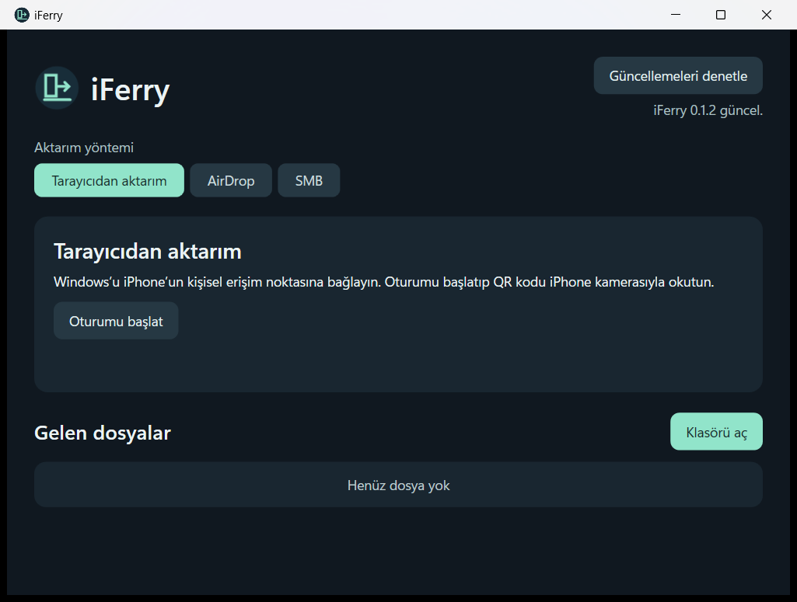

# iFerry

[Türkçe](#türkçe) · [English](#english) · [Windows download](https://github.com/muratkorayozkan/iFerry/releases/latest)



## Türkçe

iFerry, iPhone’dan Windows’a Wi-Fi üzerinden dosya göndermek için bir WPF uygulamasıdır. Windows x64 ZIP paketini çıkarıp `iFerry.exe` dosyasını açın. .NET 10 Desktop Runtime ve ASP.NET Core Runtime gerekir.

- **Tarayıcıdan aktarım** — Windows’u iPhone’un kişisel erişim noktasına bağlayın. iFerry’de oturumu başlatın, QR kodu iPhone kamerasıyla okutun ve Safari’den dosyaları gönderin. Geçici yerel HTTP bağlantısı oturum kapanana kadar geçerlidir.
- **SMB** — iFerry’de **Paylaşımı yapılandır** ve **Aktarım hesabı oluştur** düğmelerini kullanın. İlk kurulum Windows yönetici onayı ister. iPhone’da **Dosyalar → Göz At → Sunucuya Bağlan** yoluyla uygulamadaki adresi ve aktarım hesabını kullanın.
- **AirDrop** — Geliştirme aşamasında. [Teknik durum ve kabul ölçütleri](docs/airdrop.md)

Dosyalar **Belgeler → iFerry** klasörüne kaydedilir. Dosya adına tıklayarak Windows’un varsayılan uygulamasında açabilirsiniz.

iFerry, açılışta herkese açık GitHub Releases kaynağını denetler. Yeni kararlı sürümü arka planda indirip doğrular. Kurulumu **Yeniden başlat ve güncelle** ile onaylayabilirsiniz. Uygulama klasörü yazılabilir olmalıdır.

## English

iFerry is a WPF app for sending files from an iPhone to Windows over Wi-Fi. Extract the Windows x64 ZIP and open `iFerry.exe`. The app requires .NET 10 Desktop Runtime and ASP.NET Core Runtime.

- **Browser transfer** — Connect Windows to your iPhone’s Personal Hotspot. Start a session in iFerry, scan the QR code with the iPhone camera, and send files from Safari. The temporary local HTTP link is valid while the session is open.
- **SMB** — Configure the share and set up the transfer account in iFerry. Initial setup requires Windows administrator approval. On the iPhone, go to **Files → Browse → Connect to Server** and use the address and transfer account shown in the app.
- **AirDrop** — In development. [Technical status and acceptance criteria](docs/airdrop.md)

Received files appear in **Documents → iFerry**. Click a file to open it in its default Windows application.

iFerry checks public GitHub Releases at startup. It downloads and verifies new stable versions in the background. Approve installation with **Restart and update**. The app directory must be writable.

## Derleme / Build

Windows üzerinde .NET 10 SDK ile repo kökünden çalıştırın. Run from the repository root on Windows with the .NET 10 SDK.

```powershell
dotnet run --project src/iFerry.csproj
dotnet publish src/iFerry.csproj -c Release --self-contained false -r win-x64 -o artifacts/iFerry
```

Sürüm, GitHub etiketi ve ZIP adı eşleşmelidir. ZIP’in kökünde yayımlanan sekiz çalışma dosyasını tutun ve PDB dosyasını dışarıda bırakın. GitHub varlığı `uploaded` durumunda olmalı ve SHA-256 özeti sunmalıdır.

The project version, GitHub tag and ZIP name must match, for example `0.1.2`, `v0.1.2` and `iFerry-v0.1.2-Windows-x64.zip`. Include the eight published runtime and setup files at the ZIP root, excluding the PDB. The GitHub asset must be in the `uploaded` state and expose its SHA-256 digest.
